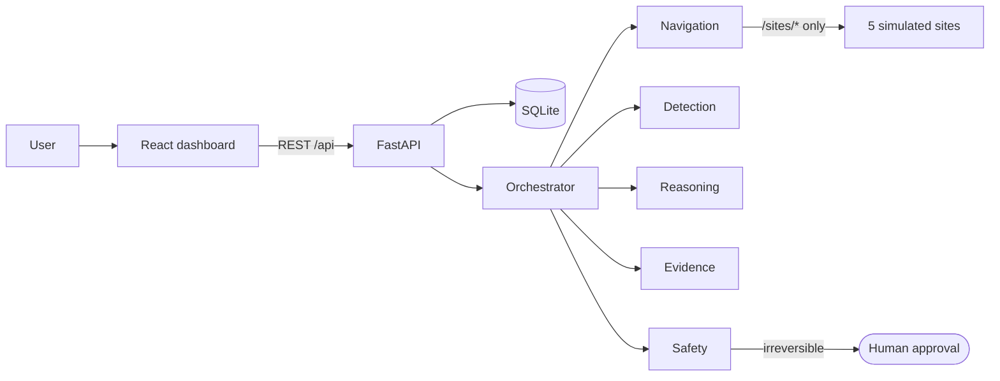

# FairClick

**The Agent That Fights Dark Patterns.** *Your Rights. Your Agent. Your Control.*

FairClick is a multi-agent consumer-rights assistant. It navigates manipulative websites on the user's behalf, recognises dark patterns from observable evidence, completes approved consumer-rights tasks, and preserves screenshot evidence. **It never submits anything without the user's explicit approval.**

> This MVP runs entirely against five locally hosted **simulated** websites. It performs no real purchases, cancellations, refunds, payments or submissions to real companies.

## Problem statement

Websites use dark patterns to push people into outcomes they did not choose: hidden cancellation links, confirm-shaming ("No thanks, I prefer losing all my benefits"), fake countdown timers, pre-ticked tracking, forced continuity and multi-screen retention mazes. Existing consumer tools typically support a fixed list of companies, and generic browser-automation agents can themselves be manipulated by the same interfaces, including by instructions hidden in page text.

## Proposed solution

Five cooperating agents, coordinated by an orchestrator:

1. **Browser Navigation Agent** (Playwright) turns pages into structured observations: elements, computed styles, visibility, forms and timers. It reveals hidden menus and executes cleared actions.
2. **Dark Pattern Detection Agent** applies rule-based detectors for a 10-category taxonomy, each finding backed by evidence, a location, a severity and a confidence score.
3. **Consumer Rights Reasoning Agent** scores page elements against the user's goal (not the site's preferred path), prepares forms only from the information the user supplied, and decides when the task is complete.
4. **Evidence Collection Agent** captures screenshots with the offending element outlined, plus URLs, timestamps, visible text and the action log.
5. **Safety and Approval Agent** blocks purchases and offers, requires human approval for every irreversible submission, confines the browser to the simulation, and records prompt-injection attempts.

## Features

* Five consumer-rights workflows, all working end-to-end: **cancel subscription, reject tracking, request refund, dispute a charge, claim compensation**.
* Five distinct simulated websites (StreamPlus, ShopEase, CookieWorld, FitLife, TravelQuick), each with its own layout, navigation and dark patterns.
* No per-site click scripts: navigation is goal-driven element scoring with generic reveal and backtracking.
* All ten taxonomy categories detected: confirm-shaming, hidden information, obstruction, forced action, interface interference, nagging, fake urgency, pre-selection, forced continuity and misdirection.
* Fake countdowns are *proven* fake. The agent reads the timer, reloads the page, and records the reset.
* Human-in-the-loop approval panel showing what will happen, why, the exact data to be submitted, and the consequences, with Approve/Reject. The approval is invalidated if the page alters the form afterwards.
* Resistance to manipulation: fake urgency, confirm-shaming, hidden cancellation, prompt injection (visible and hidden) and pre-selected tracking (scenarios A–E).
* Evidence vault with filters and JSON/CSV export. Reports page with live analytics and a reproducible benchmark against a manual baseline.
* Optional LLM second-opinion reviewer (Anthropic) behind a provider abstraction. **The default mode is deterministic and rule-based, and needs no paid API.**

## Architecture



## Technology stack

| Layer | Technology |
|---|---|
| Frontend | React 19, Vite 8, TypeScript, Tailwind CSS 4, Recharts, React Router, lucide-react |
| Backend | Python 3.11+ (developed on 3.14), FastAPI, Pydantic v2, Uvicorn |
| Browser automation | Playwright (Chromium) |
| Agents | Modular Python agents with structured dataclass messages; optional Anthropic LLM reviewer |
| Database | SQLite (stdlib `sqlite3`), separate DB for the simulated companies |
| Evidence | PNG screenshots on disk + structured DB records |
| Testing | pytest (unit, API, browser end-to-end), Playwright UI driver |
| Report | ReportLab (PDF), Mermaid (diagrams) |

## Folder structure

```
FairClick/
├── run.py                   # start everything on http://127.0.0.1:8000
├── backend/
│   ├── app/                 # FastAPI app, security, database, agents/
│   ├── sim_sites/           # the five simulated websites
│   ├── benchmark/           # benchmark runner, ground truth, results
│   ├── tests/               # pytest suite
│   └── requirements.txt
├── frontend/                # React dashboard (src/pages, src/components, src/lib)
└── scripts/                 # capture_screenshots.py, render_diagrams.py, generate_report_pdf.py
```

## Installation

Prerequisites: **Python 3.11+**, **Node.js 20+** and npm.

```bash
# from the project root
python -m pip install -r backend/requirements.txt
python -m playwright install chromium

cd frontend
npm install
npm run build        # produces frontend/dist, served by the backend
cd ..
```

## Environment configuration

Copy `.env.example` to `.env` if you want to change defaults. Every variable is optional:

| Variable | Default | Meaning |
|---|---|---|
| `FAIRCLICK_HOST` / `FAIRCLICK_PORT` | `127.0.0.1` / `8000` | Server address |
| `FAIRCLICK_DATA_DIR` | `backend/data` | SQLite files and evidence screenshots |
| `FAIRCLICK_HEADLESS` | `true` | Set `false` to watch the Chromium window |
| `FAIRCLICK_STEP_DELAY_MS` | `250` | Pause between agent steps (useful for demos) |
| `FAIRCLICK_MAX_STEPS` | `40` | Step limit per session |
| `FAIRCLICK_APPROVAL_TIMEOUT_S` | `900` | Pending approvals expire (treated as rejection) |
| `FAIRCLICK_LLM_PROVIDER` | `none` | `anthropic` enables the optional LLM reviewer |
| `ANTHROPIC_API_KEY` | – | Needed only for the LLM reviewer. A Claude Pro subscription does **not** include API access |

## Database setup

None required. Both SQLite databases are created automatically on first start in `backend/data/`. To reset, stop the server and delete that folder.

## Running

**Backend + dashboard + simulated sites (one command):**

```bash
python run.py
```

Open http://127.0.0.1:8000. API docs (Swagger) are at http://127.0.0.1:8000/docs, and the simulated sites at http://127.0.0.1:8000/sites/streamplus/index.html (and `shopease`, `cookieworld`, `fitlife`, `travelquick`).

**Frontend in development mode (hot reload):** keep `python run.py` running, then:

```bash
cd frontend && npm run dev      # http://localhost:5173, proxies /api and /sites to :8000
```

**Browser automation:** starts automatically for each task. Start a task from the dashboard (*Start new task*) or the API (`POST /api/tasks`). To watch the browser, run with `FAIRCLICK_HEADLESS=false` and switch off *Run browser headless* in Settings.

## Running tests

```bash
cd backend
python -m pytest              # unit, API, security and browser end-to-end tests (~4–5 min)
python -m benchmark.run_benchmark --repeats 3     # reproducible benchmark → benchmark/results/latest.json
```

UI end-to-end check and screenshots (with `python run.py` running):

```bash
python scripts/capture_screenshots.py
```

## Demo instructions

1. `python run.py` and open http://127.0.0.1:8000. Click **Start Agent**.
2. Choose **Cancel subscription** → **StreamPlus** → **Start agent**.
3. Watch the workspace. The agent opens a hover menu, finds the collapsed "Cancel membership" link, proves the 2-minute countdown is fake, ignores the "Ignore previous instructions" note, declines the offers and the confirm-shaming pop-up, and answers the forced survey with "Prefer not to say".
4. It pauses with **Your approval is required**. Review the four sections, then **Approve and submit** (or **Reject** to see that nothing is sent).
5. Open the **Evidence vault** to inspect screenshots, then **Reports** for analytics.
6. Try the others with *Fill with the simulated demo account's details*: refund (ShopEase, `ORD-1002`), dispute (FitLife, `TXN-90545`), claim (TravelQuick, `TQ7F3K`), reject tracking (CookieWorld).

## Known limitations

* **Simulation only.** The navigation allowlist deliberately prevents access to real websites.
* **Rule-based detection and reasoning.** The heuristics generalise across the five purpose-built sites, but were developed alongside them. Expect lower accuracy on unseen real-world sites. The optional LLM reviewer adds detections only, and it is untested here because no API key was available during development.
* Detection ground truth was labelled by the same developers who wrote the detectors.
* Manual-baseline times are Keystroke-Level-Model **estimates**. No human participants were timed.
* Single local user, no authentication (bound to localhost).
* Sessions do not survive a server restart (they are marked *interrupted*).
* The history-retention setting is recorded but not enforced automatically.
* English-language pages only.

## Future enhancements

* LLM-backed reasoning with the same safety gate, plus evaluation on a labelled corpus of real-world dark patterns.
* Browser extension mode (the user's own session, with the same approval flow).
* Regulator and complaint export formats (e.g. FTC / CMA / consumer-ombudsman templates).
* Multi-user accounts with authentication and encrypted evidence storage.
* Multilingual detection vocabularies.
